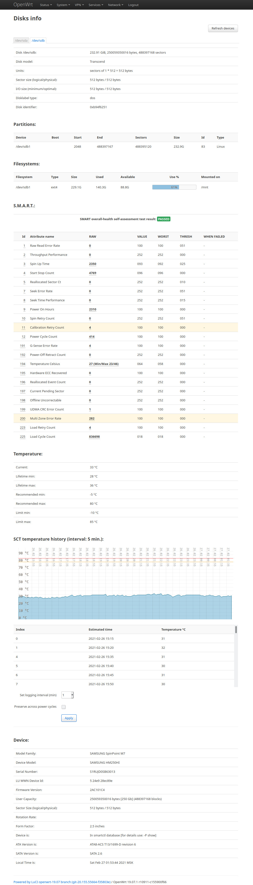

# luci-app-disks-info
Status of connected disk devices (partitions, filesystems, SMART) for LuCI (OpenWrt webUI).

OpenWrt >= 22.03.

**Dependences:** ucode, ucode-mod-fs, fdisk, smartmontools, smartmontools-drivedb.

Mounted filesystems are mapped to physical disks through the kernel's sysfs
partition and holder relationships. This supports direct mounts, mdadm arrays,
and device-mapper layers above arrays without hardcoded device or mount names.
A shared filesystem appears once under each member disk; its usage figures
describe the mounted filesystem, rather than the individual RAID member.

Mount discovery regression tests can be run from the repository root on a system
with ucode and ucode-mod-fs installed:

    ucode tests/mounts.uc

The filesystem table rendering tests require Node.js:

    node tests/view.js

## Installation notes

**OpenWrt >= 25.12:**

    apk update
    wget --no-check-certificate -O /tmp/luci-app-disks-info-0.6.1-r2.apk https://github.com/gSpotx2f/packages-openwrt/raw/master/25.12/luci-app-disks-info-0.6.1-r2.apk
    apk --allow-untrusted add /tmp/luci-app-disks-info-0.6.1-r2.apk
    rm /tmp/luci-app-disks-info-0.6.1-r2.apk
    service rpcd restart

i18n-ru:

    wget --no-check-certificate -O /tmp/luci-i18n-disks-info-ru-0.6.1-r2.apk https://github.com/gSpotx2f/packages-openwrt/raw/master/25.12/luci-i18n-disks-info-ru-0.6.1-r2.apk
    apk --allow-untrusted add /tmp/luci-i18n-disks-info-ru-0.6.1-r2.apk
    rm /tmp/luci-i18n-disks-info-ru-0.6.1-r2.apk

**OpenWrt <= 24.10:**

    opkg update
    wget --no-check-certificate -O /tmp/luci-app-disks-info_0.6.1-r2_all.ipk https://github.com/gSpotx2f/packages-openwrt/raw/master/24.10/luci-app-disks-info_0.6.1-r2_all.ipk
    opkg install /tmp/luci-app-disks-info_0.6.1-r2_all.ipk
    rm /tmp/luci-app-disks-info_0.6.1-r2_all.ipk
    service rpcd restart

i18n-ru:

    wget --no-check-certificate -O /tmp/luci-i18n-disks-info-ru_0.6.1-r2_all.ipk https://github.com/gSpotx2f/packages-openwrt/raw/master/24.10/luci-i18n-disks-info-ru_0.6.1-r2_all.ipk
    opkg install /tmp/luci-i18n-disks-info-ru_0.6.1-r2_all.ipk
    rm /tmp/luci-i18n-disks-info-ru_0.6.1-r2_all.ipk

## Screenshots:

